#  Programming using python - Practical Record
##Student Details

| **Field** | **Details** |
|:---|:---|
| **Name** | Karan Singh  |
| **Course** | B.Sc. (Hons.) Computer Science |
| **Semester** | I (First Semester) |
| **Roll Number** | `26570071` |
| **Subject** | Programming using python  | 
| **College** | Ramanujan College, University of Delhi |

## How to run

Install Python 3, save a program as a `.py` file.

On some systems you may need to use `python3` instead of `python`.

## Contents
1. Quadratic equation
2. Prime numbers
3. Star pyramids
4. Character classification
5. String operations
6. Swap prefixes of two strings
7. Substring indices
8. Cubes of even integers
9. File handling
10. Dictionary of cubes
11. Tuple operations
12. Employee class and object counting
13. Class Point2D
14. Inheritance: class Point3D
15. Exception handling for a name

---

## Practical 01 - Roots of a Quadratic Equation

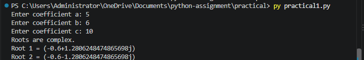
## Practical 02 - output

### Practical 02 - Prime Numbers
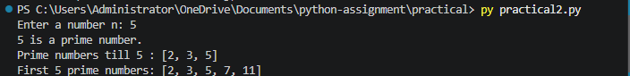

---

## Practical 03 -Star Pyramids
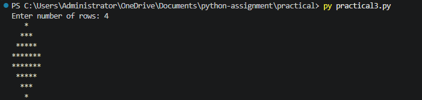
---

## Practical 04 - Character Classification
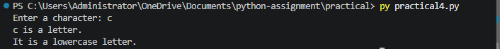

---
## Practical 05 - String Operations
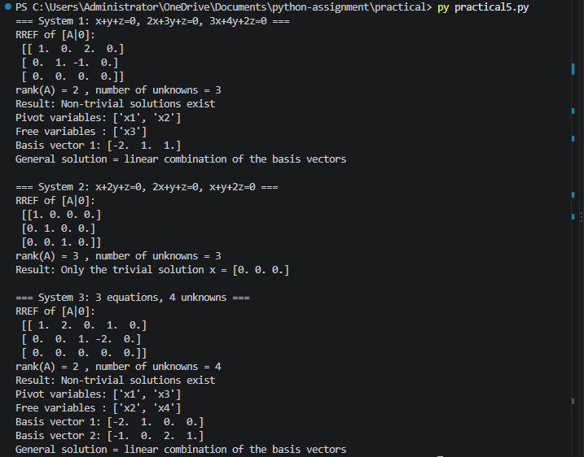

---
## Practical 06 - Swap the First n Characters of Two Strings
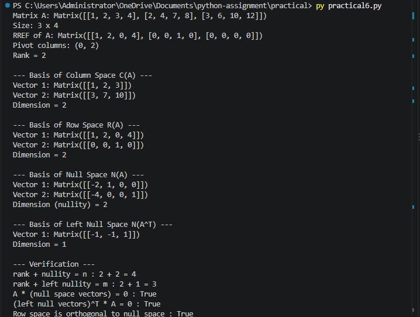

---
## Practical 07 - Find All Indices of a Substring
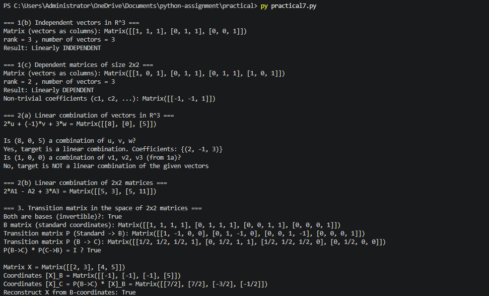

---
## Practical 08 - Cubes of Even Integers in a List
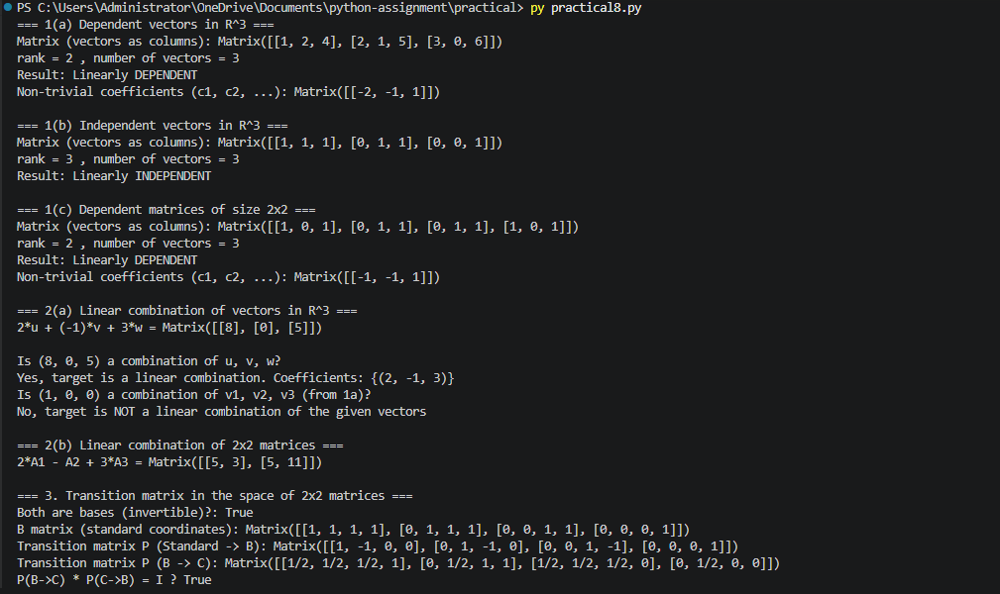

## Practical 08 - Output
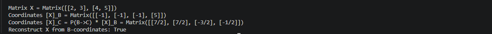
---
Practical 09 - File Handling
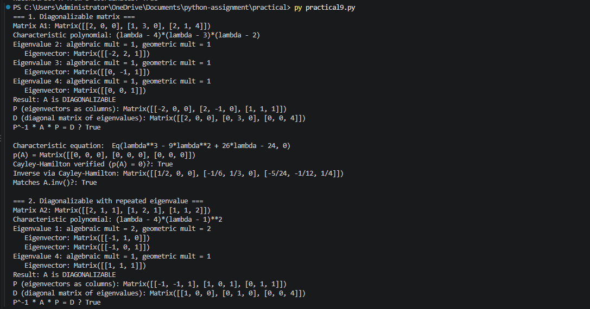
---
## Practical 09.1 - Output
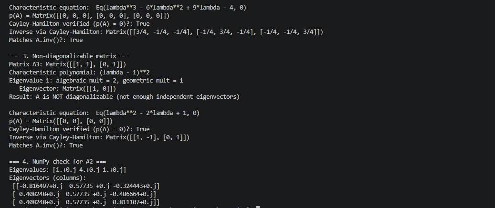

---
## Practical 10 - Dictionary of Cubes
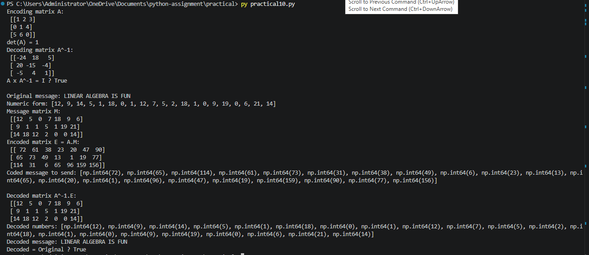

---
## Practical 11 - Tuple Operations
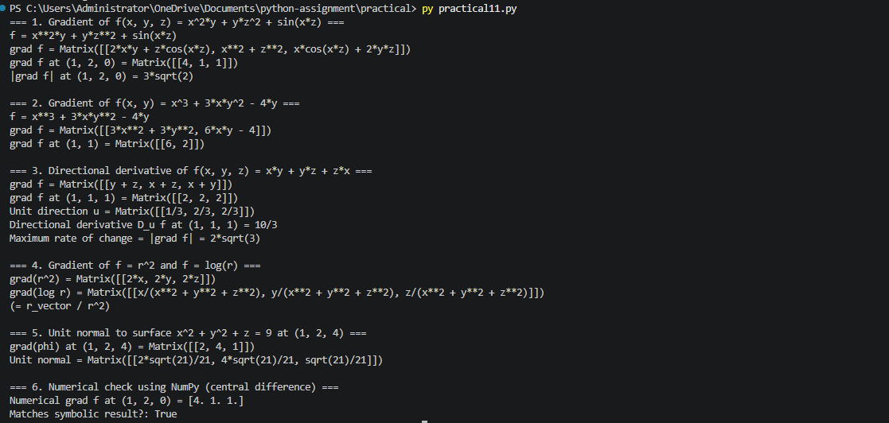

---
v
## Practical 12 - Employee Class and Object Counting
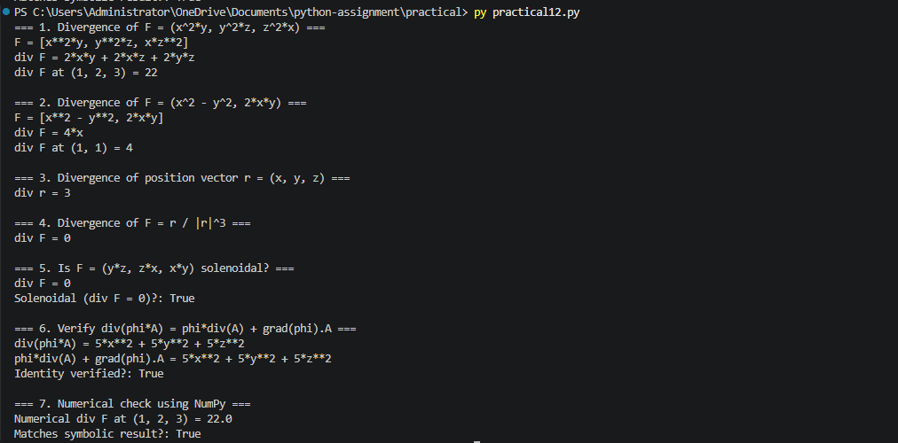

---
## Practical 13 - Class Point2D
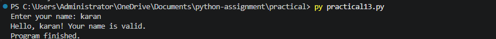
---
